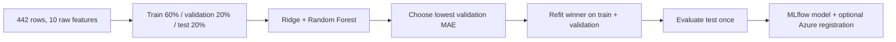

# Azure ML + MLflow Lab

**Carlos Falconi · Microsoft Learn practice**

A small regression experiment to practise training scripts, Azure Machine Learning
command jobs, and MLflow tracking. This is my adaptation of
[Run training scripts and track models with MLflow in Azure Machine Learning](https://learn.microsoft.com/en-us/training/modules/run-training-scripts-track-models-mlflow/).

The original Microsoft exercise uses classification. This version uses a bundled
regression dataset, compares two models on the same validation split, and keeps a
separate test set. It is a learning project, not a clinical application.

## The workflow



One Azure ML command job runs the script. MLflow records a parent run for the
experiment and two nested candidate runs. Azure supplies the tracking connection;
the same script also works locally.

| Component | Purpose |
|---|---|
| scikit-learn | Dataset, splits, preprocessing, two regressors and metrics |
| MLflow | Parameters, candidate metrics, plot, signature and model artifacts |
| Azure ML SDK v2 | Submit a command job and register its model output |
| Azure Identity | Authenticate using the local Azure sign-in |
| Notebook | Explain each stage and inspect the results |

## Start locally

Use Python 3.11. From the repository folder:

```bash
python3.11 -m venv .venv
source .venv/bin/activate
pip install -r requirements.txt
python src/train.py --tracking-uri sqlite:///mlflow.db
python -m unittest discover -s tests -v
mlflow ui --backend-store-uri sqlite:///mlflow.db
```

Open the local MLflow UI at `http://127.0.0.1:5000`. The final model and evaluation
files are saved to `outputs/local/`. Each execution needs an empty model folder;
for another experiment, choose a new output path:

```bash
python src/train.py --tracking-uri sqlite:///mlflow.db \
  --output-dir outputs/second-run --model-output outputs/second-run/model
```

The walkthrough is [notebooks/01_azure_ml_walkthrough.ipynb](notebooks/01_azure_ml_walkthrough.ipynb).
Select the `.venv` Python interpreter in your notebook editor. Its cloud cells are
disabled by default; inspect the job before enabling submission.

## Run in Azure ML

Use an existing Azure subscription and workspace. Sign in with `az login`, copy
`.env.example` to `.env`, and fill in the resource settings. No keys are required
in this project.

With an existing CPU compute cluster:

```bash
python scripts/submit_job.py --compute YOUR_COMPUTE --wait --register
```

The default environment uses the pinned packages in `environment/conda.yml`; the
first run can take longer while Azure builds it. To use an existing compatible
environment, pass its immutable asset reference:

```bash
python scripts/submit_job.py --compute YOUR_COMPUTE \
  --environment azureml:YOUR_ENVIRONMENT:VERSION --wait --register
```

Alternatively, serverless CPU compute can be requested explicitly:

```bash
python scripts/submit_job.py --serverless --instance-type YOUR_AVAILABLE_CPU_SKU \
  --environment azureml:YOUR_ENVIRONMENT:VERSION --wait --register
```

Choose a size available in your region and subscription quota. A curated environment
such as `azureml://registries/azureml/environments/sklearn-1.5/labels/latest` can avoid
a custom build, but record its resolved version and installed packages with the
results because its dependencies differ from the local pins.

The submission script uploads only `src/`, uses one instance, and limits the job
to 10 minutes. It does not create a workspace, start a compute instance, deploy
an endpoint, or delete resources. Cloud execution and storage may incur charges;
for a dedicated cluster, use zero minimum nodes, one maximum node and an idle
scale-down setting. The job timeout is not a spending cap or a cleanup policy.

In Azure ML Studio, open **Jobs → learn-mlflow-regression**. Inspect the parent run,
the two candidate runs, metrics, model output and evaluation plot. `--register`
creates a versioned model asset after successful training; registration does not
deploy a serving endpoint.

## Evaluation choices

- **Baseline:** predict the training mean, scored on validation data.
- **Main metric:** MAE, in the target's units. RMSE and R² provide extra context.
- **Selection:** lowest validation MAE. Test metrics never choose the winner.
- **Preprocessing:** `scaled=False` loads raw features. The Ridge pipeline fits its
  scaler on training rows only; the forest does not require scaling.
- **Final fit:** clone the selected configuration, train on train + validation,
  and evaluate the 89 test rows once within that execution.
- **Limits:** one small random split is useful for learning, not a reliable
  estimate for a medical deployment. A next step would be cross-validation on the
  development data, with the test set reserved until the end. Once the test result
  has been inspected, repeatedly tuning against it would invalidate that boundary.

## Results and verification

See [evidence/README.md](evidence/README.md) for results actually executed. Local
and Azure evidence are labelled separately. The three tests check disjoint
partitions, validation-only selection, and train-only scaler fitting.

## Project files

```text
src/train.py                         # Train, compare, select, evaluate and log
scripts/submit_job.py                # Submit to Azure and optionally register
notebooks/01_azure_ml_walkthrough.ipynb
environment/conda.yml                # Cloud training dependencies
tests/test_training.py               # Evaluation-boundary checks
evidence/                           # Recorded results, without credentials
```

## Sources

- [Microsoft Learn module](https://learn.microsoft.com/en-us/training/modules/run-training-scripts-track-models-mlflow/)
- [Microsoft's hosted exercise](https://microsoftlearning.github.io/mslearn-mlops/docs/02-optimize-model-training.html)
- [Official training repository](https://github.com/MicrosoftLearning/mslearn-mlops)
- [scikit-learn diabetes dataset documentation](https://scikit-learn.org/stable/modules/generated/sklearn.datasets.load_diabetes.html)

The data are loaded from the scikit-learn package and are not redistributed in
this repository. The dataset is the 442-row regression benchmark associated with
Efron, Hastie, Johnstone and Tibshirani's *Least Angle Regression* work, not the
Pima diabetes classification dataset. scikit-learn is distributed under BSD-3-Clause;
this repository's original code is MIT licensed. Microsoft Learn remains the
source of the exercise; this repository is an independent adaptation.
