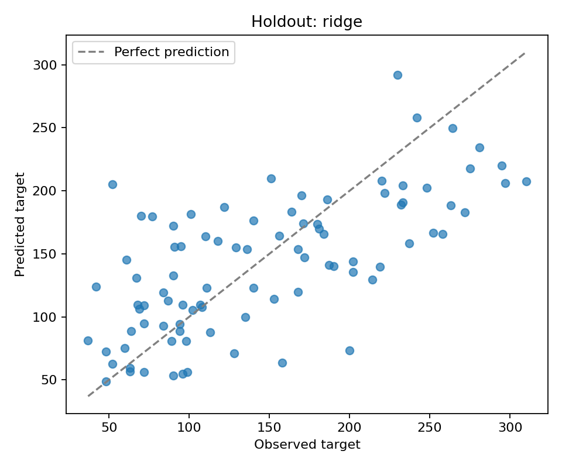

# Execution evidence

## Local verification — 12 October 2026

The training script and walkthrough notebook were executed with Python 3.11.
The source result files below come from that execution, not from a fabricated
example or an Azure run.

| Validation candidate | MAE | RMSE | R² |
|---|---:|---:|---:|
| Training-mean baseline | 64.129 | — | — |
| Ridge | 42.723 | 51.103 | 0.523 |
| Random Forest | 43.362 | 53.917 | 0.469 |

Ridge was selected by validation MAE, then refitted on the 353 development rows.
The held-out 89-row test result was MAE **42.812**, RMSE **53.777**, R² **0.454**.
This single split does not establish that Ridge is generally better than Random
Forest or that either model is suitable for clinical decisions.

- [Full local summary and package versions](local-summary.json)
- [Candidate comparison](local-comparison.csv)
- Three evaluation-boundary tests passed.
- The complete notebook executed without errors, with cloud actions disabled.
- MLflow's stored parent and two child runs were checked as `FINISHED`.
- Reloading the final MLflow model reproduced its recorded MAE; predictions were
  finite and the model contained an input signature.
- SDK validation passed for both an existing-cluster job and a serverless job.
  Schema validation alone is not evidence of cloud execution.

## Azure verification

Cloud execution and model registration are pending. No Azure result is claimed
by the local evidence above. Add the actual completed job and model version here
after they have been verified in the workspace.
